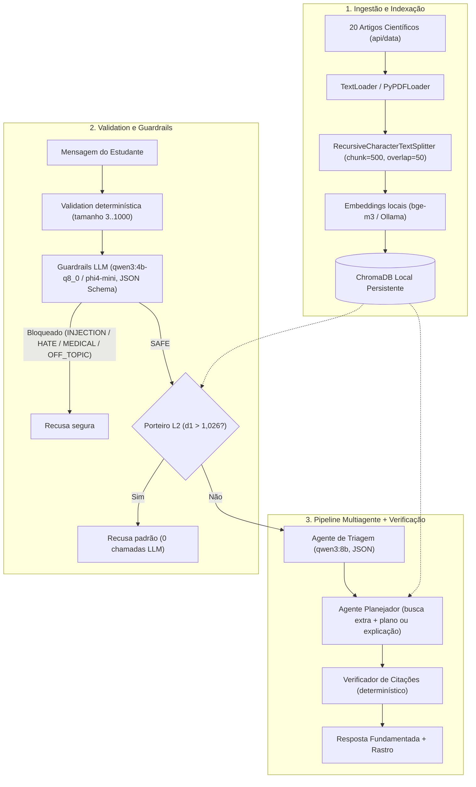

# StudyBuddy — Mentor de Estudos com RAG, Multiagente e Guardrails Locais

O **StudyBuddy** é um mentor de estudos com IA focado em **estudo monitorado por agenda**: ajuda o estudante a organizar materiais por dia da semana, montar seu calendário de estudos respeitando o **ciclo circadiano** e adaptar a carga conforme o **check-in de bem-estar**, sempre com orientações fundamentadas em literatura científica (*grounded generation*) e executadas com **modelos locais no Ollama**.

---

## Sumário

1. [Visão Geral e Arquitetura](#1-visão-geral-e-arquitetura)
2. [Estrutura do Repositório](#2-estrutura-do-repositório)
3. [Base de Conhecimento Curada (20 Artigos Científicos)](#3-base-de-conhecimento-curada-20-artigos-científicos)
4. [Pipelines da API (Clássico e Multiagente)](#4-pipelines-da-api-clássico-e-multiagente)
5. [Validation e Guardrails (Experimentação de Modelos Locais)](#5-validation-e-guardrails-experimentação-de-modelos-locais)
6. [Personas e Cenários de Validação](#6-personas-e-cenários-de-validação)
7. [Como Configurar e Executar](#7-como-configurar-e-executar)
8. [Documentação](#8-documentação)

---

## 1. Visão Geral e Arquitetura

O sistema combina uma base científica curada em **ChromaDB**, dois pipelines de resposta (**Clássico** e **Multiagente**) e camadas de **Validation determinística** e **Guardrails com modelos locais** via Ollama.



---

## 2. Estrutura do Repositório

```text
studybuddy/
├── api/                                      # Backend (FastAPI, arquitetura em camadas)
│   ├── app/
│   │   ├── core/config.py                    # Configurações e modelos Ollama via variáveis de ambiente
│   │   └── modules/
│   │       ├── assistente/                   # Rotas HTTP (/assistente/perguntar, /assistente/info)
│   │       ├── rag/                          # Núcleo RAG: ChromaDB, porteiro, prompts, llm.py, verificador.py
│   │       └── agentes/                      # Multiagente: triagem.py, planejador.py, orquestrador.py, guardrails.py
│   ├── data/                                 # Base de conhecimento: 20 artigos científicos (.txt)
│   ├── chroma_db/                            # Índice vetorial ChromaDB (gerado localmente, ignorado no git)
│   ├── tests/                                # Testes unitários sem LLM (rodam no CI)
│   ├── demo.py                               # Demonstração interativa e comparativa dos pipelines
│   ├── .env.example                          # Variáveis de ambiente (copie para api/.env)
│   └── requirements.txt
├── web/                                      # Frontend (Next.js, módulos em src/modules/)
├── pesquisa/
│   ├── rag_pipeline_semana2.ipynb            # Notebook de ingestão, indexação e pipeline RAG
│   ├── rag_avaliacao_semana3.ipynb           # Avaliação de recuperação e geração (Semana 3)
│   ├── experimentos_semana3_llm_vs_rag.ipynb # Comparação LLM puro vs RAG
│   ├── metricas/                             # Pacote de métricas (recuperação, geração, comparação)
│   ├── experimentos/
│   │   └── modelos/                          # Experimento de modelos locais nos Guardrails
│   │       ├── guardrails.md                 # Tabela comparativa, variações e recomendação final
│   │       ├── harness_guardrails.py         # Harness reproduzível (Ollama HTTP API, sem deps extras)
│   │       ├── fixtures_guardrails.json      # 48 fixtures (4 barreiras + válidos + limítrofes)
│   │       ├── resultados_guardrails.csv     # Métricas consolidadas em CSV
│   │       └── resultados_guardrails.json    # Resultados completos por caso e hardware
│   ├── Entrega2.md                           # Resumo da entrega da Semana 2
│   └── Entrega4.md                           # Sistema multiagente: arquitetura, agentes e comparação
├── docker-compose.yml                        # Dois ambientes: pipeline clássico (8001) e multiagente (8002)
├── .github/workflows/ci.yml                  # CI: backend (sintaxe, imports e pytest) e frontend (tsc e build)
└── README.md                                 # Documentação principal do repositório
```

> O notebook `pesquisa/rag_pipeline_semana2.ipynb` lê `api/data/` e grava o índice em `api/chroma_db/`, consumido pela API.

---

## 3. Base de Conhecimento Curada (20 Artigos Científicos)

A base em `api/data/` reúne **20 documentos baseados em literatura científica** de psicologia cognitiva, neurociência do aprendizado e engenharia de produtividade, segmentados com `RecursiveCharacterTextSplitter` (`chunk_size = 500`, `chunk_overlap = 50`, gerando **49 chunks** rastreáveis):

| Bloco Temático | Documentos | Referências Principais |
| :--- | :--- | :--- |
| **1. Retenção e Neurociência** | Docs `01` a `05` | *Active Recall* (Karpicke & Roediger, 2008), Repetição Espaçada (Cepeda et al., 2006), Prática Intercalada (Rohrer & Taylor, 2007), Teoria da Carga Cognitiva (Sweller, 2005) e Consolidação da Memória no Sono (Walker, 2009). |
| **2. Foco e Produtividade** | Docs `06` a `10` | *Deep Work* (Newport, 2016), Resíduo de Atenção (Leroy, 2009), Intenções de Implementação *Se-Então* (Gollwitzer, 1999), *Timeboxing* (Allen & Pozen, 2012) e Técnica Pomodoro (Cirillo, 2006). |
| **3. Comportamento e Procrastinação** | Docs `11` a `15` | Teoria da Motivação Temporal (Steel, 2007), Perfeccionismo e *Overplanning* (Flett & Hewitt, 2002), Loop do Hábito (Wood & Rünger, 2016), Esgotamento do Ego/Fadiga Decisória (Baumeister et al., 1998) e Autoeficácia (Bandura, 1977). |
| **4. Planejamento Autodidata e Editais** | Docs `16` a `20` | Princípio de Pareto 80/20 (Box et al., 1987), Ciclos de Estudo Flexíveis (Meirelles & Perez, 2015), *Project-Based Learning* (Thomas, 2000), Dupla Jornada CLT e Pobreza de Tempo (Martins & Silveira, 2020) e Técnica Feynman (Gleick & Goodstein, 1992). |

---

## 4. Pipelines da API (Clássico e Multiagente)

A API oferece dois pipelines sobre o mesmo núcleo RAG (`bge-m3`, `qwen3:8b`, `Top-K = 5`, porteiro `τ = 1,026`, `temperature = 0.0`):

| Pipeline | Fluxo | Código |
| :--- | :--- | :--- |
| **Clássico** | Busca `k=5` → porteiro L2 → geração fundamentada → verificador de citações | `api/app/modules/rag/classico.py` |
| **Multiagente** | Planejador verifica escopo → **Triagem** diagnostica restrições e consultas (JSON) → **Planejador** reúne evidências extras e gera plano ou explicação → verificador de citações | `api/app/modules/agentes/` |

Detalhes completos de arquitetura, rastro dos agentes e métricas em [`pesquisa/Entrega4.md`](pesquisa/Entrega4.md).

---

## 5. Validation e Guardrails (Experimentação de Modelos Locais)

A proteção da API é dividida em duas camadas complementares:

- **Validation (determinística, sem LLM):** limite de tamanho da pergunta (`3` a `1000` caracteres em `assistente/schemas.py`), porteiro de distância L2 (`d1 > 1,026` em `rag/repository.py`), verificador de citações (`rag/verificador.py`) e tratamento de erros/timeouts do Ollama (`503`/`504`).
- **Guardrails (classificadores LLM locais — barreiras `[4.4]` a `[4.7]`):** classificam cada entrada em `SAFE`, `INJECTION`, `HATE_SPEECH`, `MEDICAL_ADVICE` ou `OFF_TOPIC` com saída JSON estruturada (`ESQUEMA_GUARDRAILS`) e parser *fail-closed* em `api/app/modules/agentes/guardrails.py`.

### Resultados do benchmark local (`Apple M4, 10 núcleos, 24 GB RAM`)

Foram avaliados **5 modelos candidatos + 4 variações** (`temperature`, `reasoning`, quantização `Q4_K_M` vs `Q8_0` e saída estruturada `format`) sobre **48 fixtures** (8 por barreira + 8 válidos de estudo/agenda/ciclo circadiano/bem-estar + 8 limítrofes):

| Modelo (Quantização) | Tipo | Recall `INJ` | Recall `HATE` | Recall `MED` | Recall `OFF` | FP Total | F1 | Latência Média (p95) | Memória |
| :--- | :--- | :---: | :---: | :---: | :---: | :---: | :---: | :---: | :---: |
| **`qwen3:4b-q8_0`** (`Q8_0`) ⭐ | Gatekeeper | **100%** | **100%** | **100%** | **100%** | **0,0%** | **1,000** | 5,94 s (7,88 s) | 4,70 GB |
| **`phi4-mini`** (`Q4_K_M`) 🪶 | Gatekeeper | **100%** | **100%** | **100%** | **100%** | 6,2% | 0,985 | **3,89 s (5,23 s)** | **2,88 GB** |
| **`gemma3:4b`** (`Q4_K_M`) | Gatekeeper | 87,5% | **100%** | **100%** | **100%** | **0,0%** | 0,984 | 8,38 s (9,76 s) | 2,70 GB |
| **`qwen3:4b`** (`Q4_K_M`) | Gatekeeper | 100% | 100% | 100% | 100% | 68,8% | 0,853 | 9,44 s (18,01 s) | 2,95 GB |
| **`llama-guard3:1b`** (`Q8_0`) | Moderação | 37,5% | **100%** | **100%** | 12,5% | **0,0%** | 0,769 | **0,41 s (0,49 s)** | **1,67 GB** |
| **`llama-guard3:8b`** (`Q4_K_M`) | Moderação | 12,5% | **100%** | **100%** | 12,5% | **0,0%** | 0,727 | 1,79 s (2,22 s) | 5,18 GB |

### Modelos configurados em `api/app/core/config.py` (sem mexer no código)

- **Principal (`OLLAMA_GUARDRAILS_MODEL`):** `qwen3:4b-q8_0` — único com **48/48 acertos (`F1 = 1,000`)**, `0%` de falso positivo (inclusive em casos limítrofes de sono, bem-estar e ciclo circadiano) e `p95 = 7,88 s`.
- **Alternativa mais leve (`OLLAMA_GUARDRAILS_FALLBACK_MODEL`):** `phi4-mini` — **100% de recall** nas 4 barreiras, `0%` de FP em pedidos válidos, **3,89 s** de latência média e apenas **2,88 GB** de memória.
- **Parâmetros obrigatórios (`api/app/modules/rag/llm.py`):** `temperature=0.0`, `reasoning=False`, `format=ESQUEMA_GUARDRAILS` e `timeout=15.0`.

Relatório completo (incluindo análise de erros e recomendações por barreira `[4.4]`–`[4.7]`) em [`pesquisa/experimentos/modelos/guardrails.md`](pesquisa/experimentos/modelos/guardrails.md).

### Validation Determinística da Grade (Agenda e Integridade Circadiana)

A validação de grade em `api/app/modules/agentes/validation.py` opera de forma **100% determinística (zero chamadas a LLM)**, recebendo `PropostaGrade` + `ContextoEstudante` (contratos Pydantic em `api/app/modules/agentes/contratos.py`) e devolvendo `ResultadoValidacao` (`APROVADO` ou `REPROVADO` com a lista de `Violacao`).

| Regra | O que verifica | Detalhes de funcionamento |
| :--- | :--- | :--- |
| **`CONFLITO_AGENDA`** | Nenhum bloco sobreposto a eventos ocupados | Compara intervalos semiabertos `[inicio, fim)` contra `ContextoEstudante.ocupados` (eventos do Google Agenda) e aceita opcionalmente um `ProvedorAgenda` para conferir compromissos recém-adicionados antes da gravação. Compromissos adjacentes (ex.: `09:00–10:00` e `10:00–10:25`) não conflitam, e eventos sobrepostos no Google Agenda são unificados para evitar violações duplicadas. |
| **`INTEGRIDADE_CIRCADIANA`** | Proteção do sono, higiene do sono, refeições e vales circadianos | Bloqueia qualquer estudo em janelas de **sono** (`sono`) ou **refeição** (`refeicoes`); bloqueia blocos de **alta carga** na **higiene do sono** (padrão: `60 min` antes do início do sono, tratando corretamente sono que cruza a meia-noite) e nos **vales circadianos/pós-prandiais** (`vales`), mantendo permitidos blocos de **baixa carga** (revisões leves/flashcards) nessas faixas. |

- **Fluxo de alteração de horários:** o Validation nunca edita a grade diretamente — ao reprovar, devolve o `bloco_id`, `dia`, `regra` e `mensagem` para o Maestro encaminhar ao **Analysis** realocar apenas os blocos violados. Os blocos só são gravados no Google Agenda (`ProvedorAgenda.gravar_blocos`) quando o resultado é `APROVADO`.
- **Testes e demonstração (sem LLM e sem Ollama, a partir de `api/`):**
  - Testes unitários com fixtures (`api/tests/fixtures/`) e garantia testada de zero chamadas a LLM: `python -m pytest tests/test_validation.py -v`
  - Demonstração dos 5 cenários automáticos: `python demo_validation.py`
  - Modo interativo para testar horários e cargas no terminal: `python demo_validation.py -i`

---

## 6. Personas e Cenários de Validação

- **Persona 1 — Lucas (Trabalhador CLT / Concurseiro):** conciliar expediente de 8h diárias com 2h de estudo noturno sem sacrificar o sono e o ritmo circadiano.
- **Persona 2 — Lisa (Estudante de Engenharia / Estagiária):** superar o *overplanning* com ciclos flexíveis na agenda semanal.
- **Persona 3 — Bob (Universitário / Autodidata em Tecnologia):** priorizar editais extensos (80/20) e consolidar o aprendizado na prática.

---

## 7. Como Configurar e Executar

### Pré-requisitos
- Python `3.10+` (CI usa `3.12`)
- [Ollama](https://ollama.com/) rodando localmente (`http://localhost:11434`)
- Node.js `22+` (para o frontend)

### 1. Baixar os modelos locais no Ollama

```bash
# Núcleo RAG e Multiagente
ollama pull bge-m3
ollama pull qwen3:8b

# Guardrails (principal + alternativa mais leve)
ollama pull qwen3:4b-q8_0
ollama pull phi4-mini
```

### 2. Configurar variáveis de ambiente (`api/.env`)

Copie `api/.env.example` para `api/.env`. Os modelos são configuráveis sem alterar código:

```env
APP_NAME=desafio2-api
DEBUG=true
CORS_ORIGINS=["http://localhost:3000"]
OLLAMA_GUARDRAILS_MODEL=qwen3:4b-q8_0
OLLAMA_GUARDRAILS_FALLBACK_MODEL=phi4-mini
```

### 3. Gerar o índice vetorial (ChromaDB)

Execute todas as células do notebook [`pesquisa/rag_pipeline_semana2.ipynb`](pesquisa/rag_pipeline_semana2.ipynb) a partir de `pesquisa/` para criar `api/chroma_db/`.

### 4. Subir API, Frontend e Demonstração

```bash
# Backend (http://localhost:8000/docs)
cd api && pip install -r requirements.txt && uvicorn app.main:app --reload

# Frontend (http://localhost:3000)
cd web && npm install && npm run dev

# Demonstração interativa no terminal (a partir de api/)
python demo.py -i

# Os dois pipelines em containers separados (clássico :8001 | multiagente :8002)
docker compose up -d --build
```

### 5. Rodar testes e reproduzir o benchmark dos Guardrails

```bash
# Testes unitários (sem LLM, mesmos do CI — a partir de api/)
python -m pytest -q

# Reproduzir o experimento de modelos locais dos Guardrails
python3 pesquisa/experimentos/modelos/harness_guardrails.py --suite completa
```

---

## 8. Documentação

- **Documentação do projeto:** [Challenge2-documentation](https://github.com/Residencia-em-IA-Challenge-2-Grupo-12/Challenge2-documentation)
- **Entrega 2 (RAG):** [`pesquisa/Entrega2.md`](pesquisa/Entrega2.md)
- **Entrega 4 (Multiagente):** [`pesquisa/Entrega4.md`](pesquisa/Entrega4.md)
- **Experimento de Modelos nos Guardrails:** [`pesquisa/experimentos/modelos/guardrails.md`](pesquisa/experimentos/modelos/guardrails.md)
