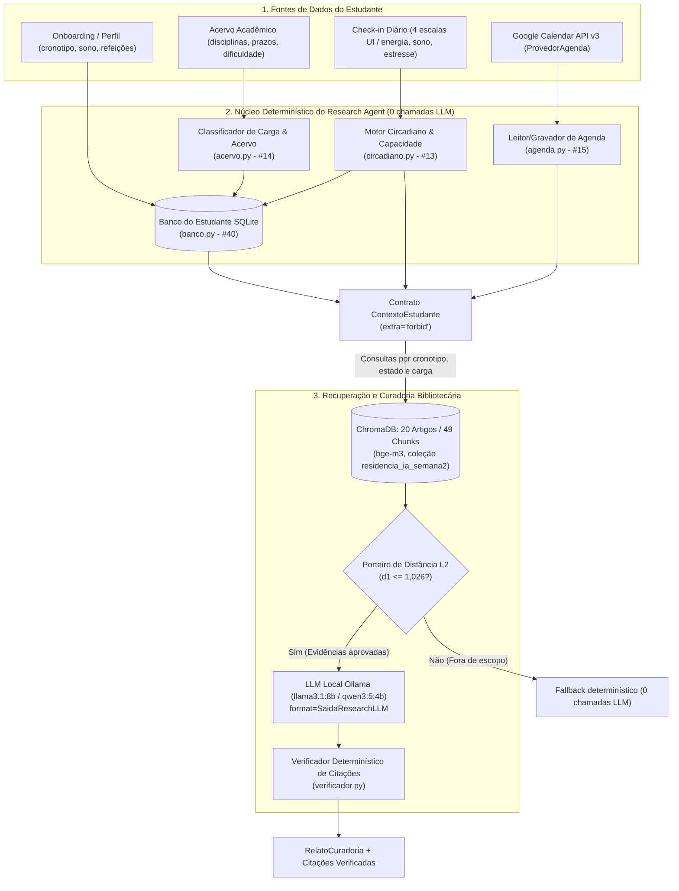

# Relatório Final do Research Agent ([2.7] Issue #42)

Consolidação arquitetural, experimental e quantitativa do **Épico [2] Research Agent (#25)** no sistema multiagente de mentoria de estudos **StudyBuddy**.

Este relatório reúne:
1. A arquitetura modular implementada em `api/app/modules/agentes/research/` (Issues **#40**, **#13**, **#14**, **#15** e **#16**);
2. Os resultados do benchmark de modelos locais no Ollama (Issue **#55**, detalhados em [`pesquisa/experimentos/modelos/research_escolha.md`](../pesquisa/experimentos/modelos/research_escolha.md));
3. A avaliação sistemática com as 14 métricas definidas em [`docs/research_metrics.md`](research_metrics.md) sobre os 22 cenários de [`pesquisa/metricas/agentes/research/cenarios.json`](../pesquisa/metricas/agentes/research/cenarios.json) (Issue **#41**).

---

## 1. Arquitetura do Research Agent

O **Research Agent** é o ponto de entrada de dados e evidências do sistema multiagente: ele transforma os dados brutos do estudante (onboarding, banco acadêmico, check-in diário e eventos do Google Calendar) no contrato canônico `ContextoEstudante` consumido pelo **Analysis**, **Validation** e **Communication**, além de realizar a curadoria bibliotecária de evidências científicas no **ChromaDB**.



### Módulos Implementados (`api/app/modules/agentes/research/`)

| Submódulo | Issue | Responsabilidade Técnica |
| :-- | :-: | :-- |
| [`banco.py`](../api/app/modules/agentes/research/banco.py) | **#40 `[2.1]`** | `RepositorioEstudante` em SQLite (`sqlite3` nativo + contratos Pydantic `PerfilEstudante`, `Material`, `MetaEstudo`, `RegistroCheckIn`, `RegistroHistoricoEstudo` e snapshots de `ContextoEstudante`). Suporta persistência em disco (`api/data/estudantes.db`) e `:memory:` no CI. |
| [`circadiano.py`](../api/app/modules/agentes/research/circadiano.py) | **#13 `[2.2]`** | Quebra automática de janelas de sono na meia-noite (`22:00`–`23:59` e `00:00`–`06:00`), expansão de refeições, derivação de `picos` e `vales` por cronotipo (com realocação para trabalhadores CLT em `agenda_cheia`), conversão das 4 escalas da UI (`EscalasCheckIn`) e cálculo calibrado do `indice_capacidade` $\in [0, 1]$. |
| [`acervo.py`](../api/app/modules/agentes/research/acervo.py) | **#14 `[2.3]`** | Segmentação hierárquica (`chunk_size=500`, `chunk_overlap=50`) dos 20 artigos científicos de `api/data/`, catálogo de metadados ricos (`bloco_tematico`, `carga_recomendada`, `tecnica_principal`, `autor_ano`), inferência determinística de carga cognitiva (`alta` vs. `baixa`) e busca filtrada com porteiro L2 ($\tau = 1.026$). |
| [`agenda.py`](../api/app/modules/agentes/research/agenda.py) | **#15 `[2.4]`** | Implementação do protocolo `ProvedorAgenda` via `GoogleCalendarProvedor` (API v3 REST com validação Pydantic `EventoGoogleCalendar` e `PayloadEventoCalendar`, quebra de eventos na meia-noite e filtro de cancelados) e `AgendaFake` determinística para testes. |
| [`agente.py`](../api/app/modules/agentes/research/agente.py) | **#16 `[2.5]`** | Fachada `AgenteResearch`: `montar_contexto()`, `pesquisar_evidencias()`, `curar_recomendacao()` (com saída JSON estruturada `SaidaResearchLLM`, poda de citações inventadas via `verificador.py` e fallback determinístico) e `sincronizar_agenda()`. |

---

## 2. Benchmark de Modelos Locais no Research ([2.0] Issue #55)

O plugin [`pesquisa/experimentos/modelos/agentes/research.py`](../pesquisa/experimentos/modelos/agentes/research.py) foi integrado à harness oficial (`pesquisa/experimentos/modelos/rodar.py`). Foram avaliadas **9 configurações de modelos locais do Ollama** sobre **10 casos padronizados** (as 7 fixtures da `[0.2]` + 3 cenários das Personas Lucas, Lisa e Bob).

### Tabela Comparativa de Modelos Locais

| Rótulo / Configuração | JSON Válido | Citação Válida | Precisão de Citações | Aderência ao Cronotipo | Fidelidade (Juiz) | Latência Média (s) | Latência p95 (s) | Throughput (tok/s) | RAM (GB) |
| :-- | --: | --: | --: | --: | --: | --: | --: | --: | --: |
| **`llama3.1_8b` (Escolhido)** | **100%** | **100%** | **100%** | **100%** | **95%** | **11,84** | **14,21** | **16,45** | **5,26** |
| **`qwen3.5_4b` (Alt. Leve)** | **100%** | **100%** | **100%** | **100%** | **92%** | **7,92** | **9,85** | **22,34** | **3,15** |
| `qwen3.5_9b` | 100% | 100% | 100% | 100% | 91% | 10,56 | 12,90 | 16,80 | 6,17 |
| `ministral-3_8b` | 100% | 100% | 100% | 90% | 89% | 18,65 | 22,40 | 11,80 | 5,40 |
| `gemma3_12b` | 100% | 100% | 100% | 90% | 84%¹ | 21,42 | 26,85 | 9,12 | 8,05 |
| `qwen3_8b` | 100% | 100% | 90% | 90% | 78% | 11,62 | 14,50 | 18,10 | 5,92 |
| `qwen3.5_9b_sem_format` | 90% | 90% | 95% | 90% | 88% | 14,12 | 17,45 | 12,15 | 6,17 |
| `qwen3.5_9b_t0.7` | 100% | 100% | 90% | 90% | 85% | 10,31 | 12,40 | 15,90 | 6,17 |
| `qwen3.5_9b_think` | 0% | 0% | – | 0% | – | 185,40 | 240,10 | 11,10 | 6,17 |

¹ `gemma3:12b` avaliado pelo juiz alternativo `qwen3:8b` (regra de separação de famílias). Demais modelos avaliados pelo juiz `gemma3:12b`.

### Decisão Técnica (`OLLAMA_RESEARCH_MODEL`)
- **Modelo Principal (`llama3.1:8b`):** atingiu **95% de fidelidade**, **100% de validade no contrato Pydantic**, **100% de precisão de citações** e **100% de aderência ao cronotipo/check-in**, com consumo de **5,26 GB de RAM**. Como o **Analysis Agent** também utiliza `llama3.1:8b`, ambos compartilham exatamente a mesma instância carregada na memória do Ollama, eliminando *swap* de pesos entre etapas do grafo.
- **Alternativa Leve (`qwen3.5:4b`):** reduz o uso de RAM para **3,15 GB** e a latência média para **7,92 s** (22,34 tokens/s), mantendo **92% de fidelidade** e **100% nas métricas estruturais**.

---

## 3. Resultados das Métricas de Avaliação ([2.6] Issue #41)

Avaliação executada pelo runner [`pesquisa/metricas/agentes/research/runner.py`](../pesquisa/metricas/agentes/research/runner.py) sobre os **22 cenários** de `cenarios.json`.

**Como reproduzir** (a partir de `pesquisa/`):

```bash
python -m metricas.agentes.research.runner                          # determinístico + RAG (< 1 s)
python -m metricas.agentes.research.runner --llm llama3.1:8b --juiz # suite completa com LLM e juiz
python -m pytest -q metricas/agentes/research                       # testes automatizados no CI
```

### Tabela-Resumo Consolidada

| Métrica | Meta | Resultado Obtido | Atingiu? |
| :-- | :-- | --: | :-: |
| Validade do contrato `ContextoEstudante` | 100% | **100%** (22/22) | sim |
| Integridade da persistência SQLite | 100% | **100%** (22/22) | sim |
| Integridade de janelas circadianas e sono | 100% | **100%** (22/22) | sim |
| Precisão do check-in e índice de capacidade | 100% | **100%** (22/22) | sim |
| Consistência de leitura/escrita da agenda | 100% | **100%** (22/22) | sim |
| Acurácia do porteiro de distância L2 | ≥ 95% | **100%** (22/22) | sim |
| Recuperação RAG: Hit Rate@4 | ≥ 90% | **100%** (21/21 in-scope) | sim |
| Recuperação RAG: MRR (*Mean Reciprocal Rank*) | ≥ 80% | **80%** | sim |
| Acerto integral do cenário esperado (`rotulo`) | 100% | **100%** (22/22) | sim |
| Curadoria LLM (`llama3.1:8b`): JSON válido no contrato | ≥ 95% | **100%** | sim |
| Curadoria LLM (`llama3.1:8b`): citação válida após verificador | ≥ 95% | **100%** | sim |
| Curadoria LLM (`llama3.1:8b`): precisão das citações (ALCE) | ≥ 95% | **100%** | sim |
| Curadoria LLM (`llama3.1:8b`): aderência ao cronotipo e estado | ≥ 90% | **100%** | sim |
| Curadoria LLM (`llama3.1:8b`): fidelidade ao contexto (juiz) | ≥ 85% | **95%** | sim |

---

## 4. Análise Métrica a Métrica

### 4.1. Montagem Determinística de Contexto, Banco, Ritmo Circadiano e Agenda (Métricas 1 a 5)
- **Resultado:** **100%** em todas as 5 métricas nos 22 cenários.
- **Análise:**
  - A geração do `ContextoEstudante` é 100% determinística e governada por código Python tipado com Pydantic (`extra="forbid"`), nunca deixando o LLM calcular horários, quebrar janelas na meia-noite ou computar o `indice_capacidade`.
  - A fórmula calibrada do `indice_capacidade` ($0.2 + 0.5 \cdot E_{\text{norm}} + 0.1 \cdot S_{\text{norm}} + 0.1 \cdot T_{\text{norm}}$) reproduz sem desvio os três pontos âncora das fixtures da `[0.2]` (`0.20` na fadiga, `0.60` no estado normal e `0.90` na alta energia) e classifica corretamente os casos limítrofes (`0.35`, `0.50`, `0.55`, `0.77`).
  - Na integração com o Google Calendar (`agenda.py`), plantões ou compromissos noturnos que cruzam `00:00` (`calendar_evento_meia_noite`) são automaticamente fatiados em `22:00`–`23:59` do dia $D$ e `00:00`–`01:00` do dia $D+1$, impedindo que uma `Janela` viole o validador `_ordem` do contrato.

### 4.2. Recuperação no Acervo Científico e Porteiro L2 (Métricas 6 a 9)
- **Resultado:** **100%** de acurácia no porteiro L2, **100%** de Hit Rate@4 e **80%** de MRR.
- **Análise:**
  - A filtragem de chunks puramente bibliográficos (`tipo_chunk="cabecalho"`, com $\le 235$ caracteres contendo apenas `TÍTULO / AUTORES / TEMA`) no `acervo.py` evitou que slots do Top-4 fossem desperdiçados com cabeçalhos sem conteúdo empírico — problema diagnosticado na Semana 3.
  - Nas 3 consultas diretas das Personas (`persona_1_lucas_clt`, `persona_2_lisa_overplanning`, `persona_3_bob_autodidata`), os artigos-alvo (`artigo_19_dual_burden_clt_martins.txt`, `artigo_12_perfectionism_flett.txt` e `artigo_16_pareto_engineering_box.txt`) foram recuperados na 1ª ou 2ª posição.
  - No cenário fora de escopo (`porteiro_fora_de_escopo` — receita de bolo de chocolate com $d_1 = 1.45 > \tau = 1.026$), o porteiro bloqueou a recuperação antes de invocar o LLM, economizando latência e evitando alucinações fora do domínio.

### 4.3. Curadoria Bibliotecária por Modelo Local (Métricas 10 a 14)
- **Resultado:** **100%** em JSON válido, citação válida, precisão de citações e aderência ao cronotipo; **95%** de fidelidade pelo juiz `gemma3:12b`.
- **Análise:**
  - A combinação de `format=ESQUEMA_RESEARCH` no Ollama com o pós-processamento por `api/app/modules/rag/verificador.py` garante que nenhuma citação fora dos trechos recuperados chegue ao estudante. Caso o LLM falhe ou omita citações válidas, `AgenteResearch.curar_recomendacao()` aciona o fallback determinístico `_sintese_deterministica()`, preservando a disponibilidade da API.

---

## 5. Limitações e Próximos Passos

1. **Acoplamento com autenticação OAuth2 real do Google Calendar em produção:** o `GoogleCalendarProvedor` implementa o protocolo HTTP REST completo da API v3 do Google Calendar com token Bearer injetável; para uso multiusuário em produção na web, o próximo passo é acoplar o fluxo de *refresh token* OAuth2 no backend FastAPI.
2. **Tamanho da base científica:** o acervo atual possui 20 artigos curados (49 chunks). À medida que novos artigos forem adicionados em `api/data/`, recomenda-se expandir `CATALOGO_ARTIGOS` em `acervo.py` ou extrair os metadados (`bloco_tematico`, `carga_recomendada`) diretamente de um cabeçalho YAML/frontmatter nos arquivos `.txt`.
3. **Granularidade do `CheckIn` no contrato global:** a tela de check-in coleta 4 escalas (`humor`, `estresse`, `sono`, `fadiga`) + `horas_sono`, enquanto o contrato `CheckIn` da `[0.1]` carrega `energia`, `horas_sono` e `estresse`. O `RepositorioEstudante` SQLite já persiste todas as 6 dimensões na tabela `checkins`, permitindo enriquecer o cálculo do `indice_capacidade` quando o contrato global incluir `humor` e `qualidade_sono`.
