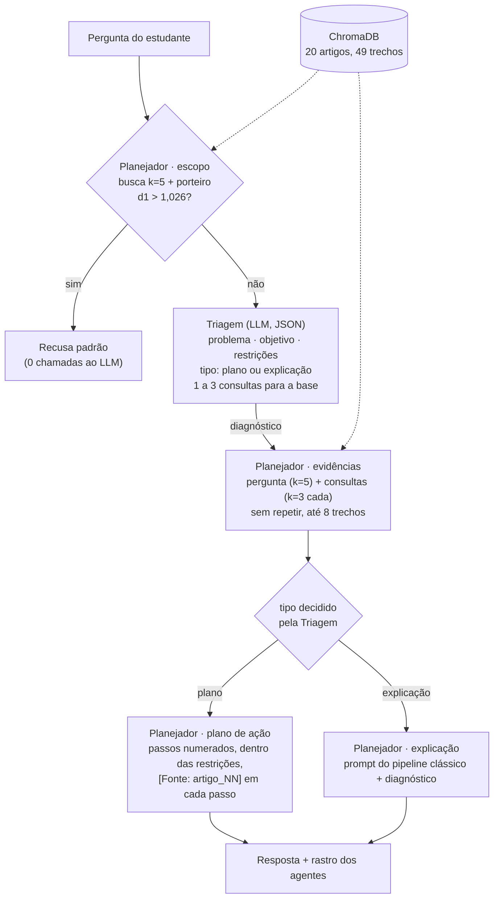

# Entrega 4: Primeiro sistema multiagente

O StudyBuddy passa a ter dois pipelines na API, lado a lado e com o mesmo núcleo RAG:

| Pipeline | O que faz | Onde |
| :-- | :-- | :-- |
| **Clássico** (T3 + porteiro, escolhido na Semana 3) | Busca k=5 → porteiro → LLM responde | `api/app/modules/rag/classico.py` |
| **Multiagente** (novo) | Planejador verifica o escopo → **Triagem** diagnostica o estudante → **Planejador** reúne evidências e monta a resposta | `api/app/modules/agentes/` |

Os dois usam o mesmo índice (`api/chroma_db`), o mesmo embedding (bge-m3), o mesmo gerador (qwen3:8b), o mesmo corte do porteiro (τ = 1,026) e o mesmo prompt de sistema (`RAG_SYSTEM_PROMPT`). A única diferença é a orquestração, o que permite comparar os dois com a avaliação da Semana 3.

## Por que estes dois agentes

O problema das personas não é "achar trechos": Lucas (CLT) precisa saber **o que fazer com 2 horas à noite**, Lisa (overplanning) precisa de **um plano que não quebre** e Bob precisa **priorizar**. O pipeline clássico busca com a pergunta crua e responde sempre no mesmo formato. Os agentes foram escolhidos onde existe uma **decisão** a tomar:

- **Triagem:** decide qual é o problema real, o que o estudante disse sobre tempo e rotina, e se ele precisa de um plano ou de uma explicação.
- **Planejador:** decide quais evidências entram (além da pergunta, as consultas da Triagem) e monta a resposta dentro das restrições do estudante.

## Arquitetura



O orquestrador (`orquestrador.py`) é código simples, sem LLM: chama os agentes em ordem, aplica o atalho do porteiro e registra cada passo num **rastro** que a API devolve. O porteiro roda **antes** da Triagem, então uma pergunta fora de escopo não gasta nenhuma chamada ao LLM.

## Responsabilidades

| | Agente de Triagem | Agente Planejador |
| :-- | :-- | :-- |
| **Pergunta que responde** | Quem é este estudante e do que ele precisa? | O que a ciência recomenda para ele, dentro do que ele pode fazer? |
| **Entrada** | A mensagem do estudante | A pergunta, os trechos iniciais e o diagnóstico da Triagem |
| **Saída** | Diagnóstico: `problema_principal` (1 de 9 categorias), `objetivo`, `restricoes` (tempo, prazo, contexto), `tipo_resposta` (plano ou explicação) e `consultas` | Resposta com fonte em cada passo, ou a recusa padrão |
| **Decisões** | Plano ou explicação; quais aspectos buscar na base | Se a pergunta está no escopo (porteiro); quais trechos entram; como encaixar o plano nas restrições |
| **Toca a base?** | Não | Sim (único agente que consulta o ChromaDB) |
| **Chama o LLM?** | 1 vez (saída JSON de esquema fixo) | 1 vez |
| **Se falhar** | JSON inválido vira diagnóstico neutro (explicação, sem consultas): o Planejador responde como o pipeline clássico | Sem trechos ou contexto insuficiente: recusa pela regra 2 do prompt |
| **Código** | `agentes/triagem.py` | `agentes/planejador.py` |

## Interação e colaboração

1. **Planejador verifica o escopo.** Busca os 5 trechos mais próximos da pergunta. Se nem o mais próximo está perto (d1 > 1,026), recusa na hora e a Triagem nem é chamada.
2. **Triagem diagnostica.** Lê a mensagem e entrega um diagnóstico estruturado. As restrições só registram o que o estudante **disse** (nada inventado), e as consultas usam o vocabulário dos artigos ("dupla jornada", "intenções de implementação"), que a pergunta coloquial não usa.
3. **Planejador reúne evidências.** Busca cada consulta da Triagem e acrescenta só os trechos novos que passam no porteiro, até 8 no total. É aqui que a Triagem muda o resultado: na demonstração, as consultas trouxeram de 2 a 3 trechos que a pergunta sozinha não encontrava (ex.: intenções de implementação para a Lisa).
4. **Planejador responde no formato decidido pela Triagem.** Num plano, monta passos concretos no tempo que o estudante disse ter. Se um artigo recomenda outro horário, isso aparece como sugestão, sem trocar o plano.

## Demonstração

A partir de `api/`, com o Ollama aberto e o índice gerado:

```bash
python demo.py                 # 5 cenários, nos dois pipelines
python demo.py --so-agentes    # só o multiagente
python demo.py "sua pergunta"
python demo.py -i              # interativo: uma pergunta atrás da outra, até "sair"
```

No modo interativo, o padrão é só o multiagente. Os comandos `:classico`, `:agentes` e `:ambos` trocam o pipeline no meio da conversa, e `:ambos` mostra as duas respostas para a mesma pergunta. Com `--url-agentes http://localhost:8002`, as perguntas vão para o container em vez de rodar localmente.

| Cenário | O que mostra |
| :-- | :-- |
| Lucas: "Trabalho 8 h em CLT e tenho 2 h livres à noite..." | Triagem extrai "2 horas à noite" e "CLT" e decide por um **plano**; o plano usa as 2 h da noite |
| Lisa: "Passo horas montando planilhas que quebram..." | Mesmo formato, outro problema (`planejamento_excessivo`); a consulta da Triagem traz intenções de implementação (artigo 08) |
| "Por que eu vou empurrando o estudo quando a prova está longe?" | Triagem decide por uma **explicação** (Teoria da Motivação Temporal) |
| "Qual o melhor remédio para dormir...?" | Passa pelo porteiro (d1 = 1,011, parece com sono); o Planejador recusa pela regra 2 do prompt |
| "Qual a capital da Austrália?" | O porteiro barra; nenhum agente chama o LLM |

Trecho real do rastro (cenário do Lucas):

```
[Planejador] verificou o escopo: pergunta dentro da base (d1=0.743); 5 trechos
[Triagem] diagnosticou → resposta tipo PLANO
    problema: sono_e_rotina
    restrições: tempo_disponivel: 2 horas à noite; contexto: trabalha em regime CLT
    consultas para o Planejador: ['organização do tempo em regime de horário fixo', ...]
[Planejador] reuniu evidências: +2 trecho(s) pelas consultas da Triagem; 7 no total
[Planejador] escreveu o plano
```

## Dois ambientes para comparar

```bash
docker compose up -d --build
# http://localhost:8001/docs -> clássico   |   http://localhost:8002/docs -> multiagente
python api/demo.py --url-classico http://localhost:8001 --url-agentes http://localhost:8002
```

Os dois containers vêm da mesma imagem e só mudam a variável `PIPELINE`. O Ollama fica no Mac, fora do Docker (dentro de container ele não usa a GPU). Cada container copia o índice para dentro ao subir, para não haver dois processos abrindo o mesmo SQLite. Ao medir latência, rode um ambiente de cada vez, porque os dois dividem o mesmo Ollama.

Sem Docker, o mesmo servidor responde aos dois: `POST /assistente/perguntar` com `{"pergunta": "...", "pipeline": "classico" | "agentes"}`.

## Comparação com a avaliação da Semana 3

Mesmas 28 perguntas, mesmo juiz (gemma3:12b), mesmas métricas. A partir de `pesquisa/`:

```bash
python -m metricas.comparacao.modos classico_api   # T3 + porteiro, pelo código da API
python -m metricas.comparacao.modos multiagente    # Triagem + Planejador
python -m metricas.comparacao.avaliar classico_api multiagente
```

O resultado entra na mesma tabela (`metricas/relatorios/comparacao.md`), ao lado de T1 a T4.

<!-- RESULTADOS -->

## Limites conhecidos

- **Custo:** o multiagente faz 2 chamadas ao LLM por pergunta válida (o clássico faz 1). A Triagem é curta (~8 a 15 s no qwen3:8b), mas soma.
- **O prompt de plano é novo.** Na Semana 3, mudar o prompt (T4) derrubou a completude. O modo "explicação" usa o prompt original; o modo "plano" precisa da avaliação para mostrar se cobre os pontos-chave tão bem quanto.
- **O formato de plano pode trazer detalhes que não estão na base** (na demonstração: "após as 23h"). A fidelidade medida pelo juiz é o que diz se isso é frequente.
- **A lógica é duplicada do notebook.** A API copia o prompt, o k e o corte do porteiro do `rag_pipeline_semana2.ipynb`, que continua gerando o índice. Se mudar lá, mude em `api/app/modules/rag/`.
